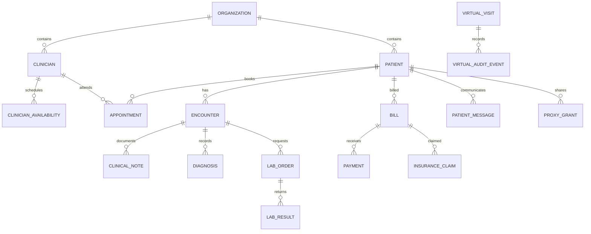

# OmniHealthcare Architecture

## Runtime

Browser -> React -> Nginx -> Django REST Framework -> PostgreSQL

- React provides the responsive role workspace.
- Hospital JWT authentication identifies hospital users.
- Django enforces tenant and role permissions in API viewsets.
- PostgreSQL persists clinical, scheduling, billing, and audit records.
- Nginx serves the React build and reverse-proxies `/api/`.
- Virtual Care is a separate Django process and database. It supports native accounts and can
  optionally accept hospital JWTs for integrated visits.

## Data ownership

Organizations are tenants. Patients, clinicians, availability, appointments, encounters, chart
records, lab records, bills, claims, messages, consents, and audit events belong to an organization.
API querysets filter by the authenticated user's organization. A patient account links to its patient
record through a foreign key. Patient proxy grants allow read-only access to specific record
categories and can be revoked by the patient who created the grant.

Clinician availability stores a weekday and local start/end time. Appointment requests are converted
using the organization's time zone (default `Africa/Nairobi`), checked against an active availability
window, and protected by database constraints against duplicate bookings. Repeated booking requests
with the same idempotency key return the original appointment.

Inpatient admissions snapshot the attending clinician, ward, bed, and room rate. A unique active
admission constraint prevents a patient or bed from being assigned twice. Bills carry an OPD/IPD
care type; inpatient lab orders are linked to an active admission and their bills are IPD, while
outpatient encounter tests remain OPD. Room charges are recorded once per completed 24-hour period
in a charge ledger linked to an IPD bill. Billing and inpatient requests reconcile overdue charges idempotently; production deployments also run the
`accrue_inpatient_room_charges` management command on a schedule.

Insurance claims are separate from payments. Claims reference a bill, record payer/member references,
amounts, draft/submitted/decision status, timestamps, and audit events. Adjudication is simulated and
does not create a payment or contact an external insurer.

Inpatient vitals and lab results reuse the patient chart records. Medication plans, administrations,
and doctor notes are admission-scoped records with role-limited write access.

## Clinical integrity

Appointment slots use a database uniqueness constraint and an atomic availability check. Encounter status
transitions are validated by the server. Completion requires a clinical note linked to the encounter and
patient. Laboratory results must match the order patient and organization. Prescriptions require clinician
authorization. Bills are server-totaled and payments cannot exceed the outstanding balance. Patient
messages are limited to the assigned clinician and linked patient account; proxy access cannot write to
shared records.

## Data model overview

The Virtual Care entities are stored in the separate service database. They use independent account
identifiers, copied into `VirtualVisit.patient_id` and `VirtualVisit.clinician_id` string fields;
they do not require hospital patient/clinician lookups in standalone mode.

## Security boundary

Hashed passwords, short-lived JWTs, role checks, tenant filtering, input validation, secure response
headers, and append-style audit events are used. The one-time Virtual Care bootstrap key must be
configured privately and removed from the runtime environment after initialization. The system has
not completed clinical or regulatory certification and is not approved for live patient care.
